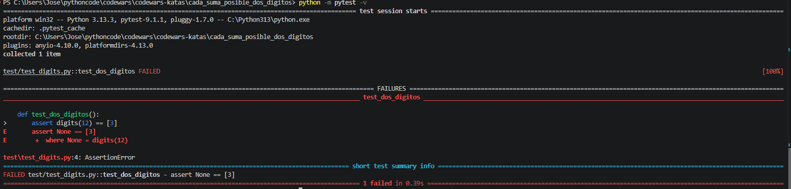
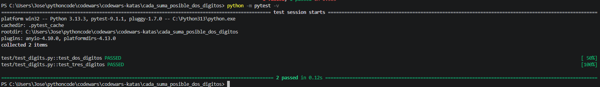
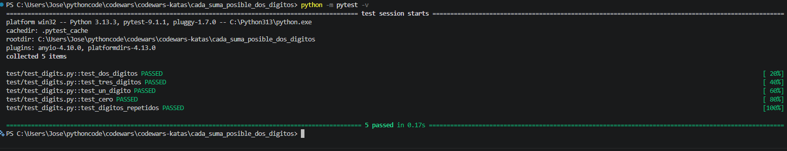
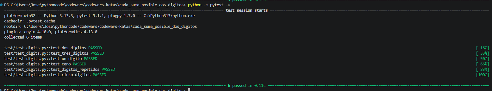

# Testing — Cada suma posible de dos dígitos

## Objetivo

Documentar las pruebas de la función `digits(n)` mediante **TDD (Test-Driven Development)** y `pytest`.

La función recibe un entero no negativo y devuelve una lista con las sumas de todas las parejas de posiciones de sus dígitos, respetando el orden de izquierda a derecha.

## Metodología: RED → GREEN → REFACTOR

- **RED:** escribir una prueba que falle para identificar el comportamiento que falta implementar.
- **GREEN:** escribir el código necesario para superar la prueba.
- **REFACTOR:** revisar la implementación y mejorarla si es necesario, manteniendo las pruebas superadas.

## 1. Primera prueba y primer GREEN

Se comienza con una función todavía sin implementar:

```python
def digits(n):
    pass
```

La primera prueba exige sumar dos dígitos:

```python
def test_dos_digitos():
    assert digits(12) == [3]
```

Inicialmente falla porque `pass` hace que la función devuelva `None`. Para superar esta primera prueba se utiliza una solución mínima y provisional:

```python
def digits(n):
    return [3]
```

La prueba queda superada. Esta implementación aún no resuelve el problema general.



## 2. Segunda prueba y solución general

Se añade una prueba con tres dígitos:

```python
def test_tres_digitos():
    assert digits(123) == [3, 4, 5]
```

La implementación provisional `return [3]` no supera esta nueva prueba. Se sustituye por una solución general con dos bucles anidados:

```python
def digits(n):
    n = str(n)
    resultado = []

    for i in range(len(n)):
        for j in range(i + 1, len(n)):
            resultado.append(int(n[i]) + int(n[j]))

    return resultado
```

Ahora se superan ambas pruebas.



## 3. Casos límite

Se añaden tres pruebas para comprobar situaciones especiales:

```python
def test_un_digito():
    assert digits(5) == []


def test_cero():
    assert digits(0) == []


def test_digitos_repetidos():
    assert digits(111) == [2, 2, 2]
```

Estas pruebas verifican que los números de un solo dígito no generan parejas y que se conservan los resultados repetidos cuando corresponden a posiciones distintas.

La solución supera las cinco pruebas.



## 4. REFACTOR

Se revisa la implementación. Los dos bucles permiten recorrer cada pareja de posiciones una sola vez, y `append()` añade las sumas en el orden esperado.

No se necesitan cambios: la solución es clara y supera las pruebas existentes.

## 5. Prueba final

Se comprueba el ejemplo completo de cinco dígitos:

```python
def test_cinco_digitos():
    assert digits(12345) == [3, 4, 5, 6, 5, 6, 7, 7, 8, 9]
```

Desde la carpeta del kata se ejecuta:

```powershell
python -m pytest -v
```

**Resultado final: 6 pruebas superadas.**



## Resumen de pruebas

| Prueba | Entrada | Resultado esperado | Estado |
|---|---|---|---|
| `test_dos_digitos` | `12` | `[3]` | PASSED |
| `test_tres_digitos` | `123` | `[3, 4, 5]` | PASSED |
| `test_un_digito` | `5` | `[]` | PASSED |
| `test_cero` | `0` | `[]` | PASSED |
| `test_digitos_repetidos` | `111` | `[2, 2, 2]` | PASSED |
| `test_cinco_digitos` | `12345` | `[3, 4, 5, 6, 5, 6, 7, 7, 8, 9]` | PASSED |

## Conclusión

La práctica ha seguido el ciclo TDD: comenzar con una prueba sencilla, implementar una solución mínima, añadir una prueba que obliga a generalizar el código y comprobar casos límite. La implementación final supera las seis pruebas automatizadas.

> Las capturas incluidas corresponden a los resultados conservados durante el desarrollo. Las fases RED también se describen, aunque no se dispone de capturas de sus fallos.
